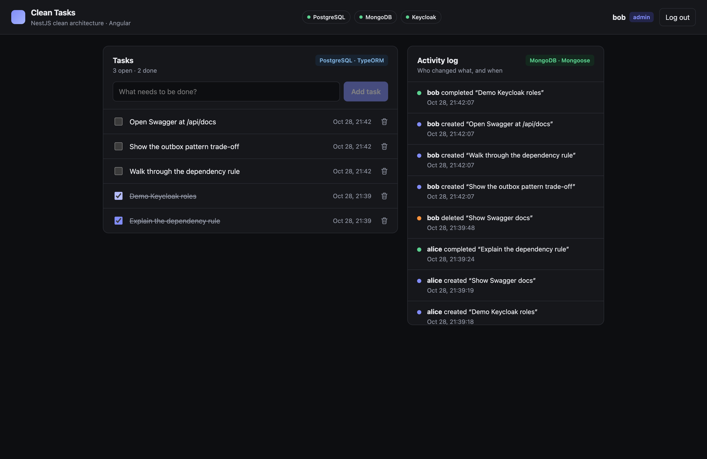
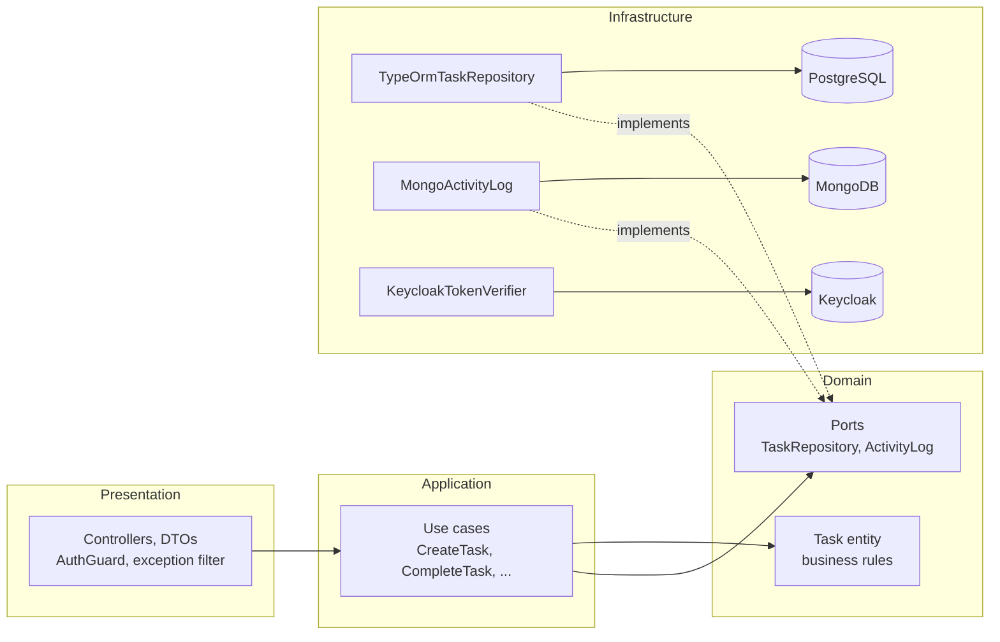

# Clean Tasks: NestJS Clean Architecture

A small full-stack example of **Clean Architecture in NestJS**, using two databases and Keycloak for auth, with an Angular client.

- **NestJS 12** API, organized in domain / application / infrastructure / presentation layers
- **PostgreSQL** (TypeORM) stores the tasks: relational data, the source of truth
- **MongoDB** (Mongoose) stores the activity log: append-only events with a flexible schema
- **Keycloak** handles login (OIDC, Authorization Code + PKCE) and roles (`user`, `admin`)
- **Angular 22** client: standalone components, signals, a functional HTTP interceptor
- Unit tests with **Vitest** that run the use cases against in-memory adapters, with no database



## Architecture



**The dependency rule:** code only depends inward. `domain/` and `application/` import nothing from NestJS, TypeORM, Mongoose or Keycloak. Infrastructure implements the ports defined by the domain, and `tasks.module.ts` is the composition root that connects them.

```
backend/src
├── domain/                  # Pure TypeScript: entities, rules, ports
│   ├── task/                # Task entity (complete/reopen rules) + TaskRepository port
│   ├── activity/            # Activity event + ActivityLog port
│   └── shared/              # Domain errors (Validation, NotFound, Conflict)
├── application/             # Use cases: one class per action, depend only on ports
│   ├── task/
│   └── activity/
├── infrastructure/          # Adapters: frameworks and drivers
│   ├── persistence/postgres # TypeORM entity, mapper, repository
│   ├── persistence/mongo    # Mongoose schema, activity log
│   ├── auth/                # Keycloak JWT verification (jose + JWKS)
│   └── health/              # /api/health, pings both databases
├── presentation/http/       # Controllers, DTOs, AuthGuard, domain error filter
├── tasks.module.ts          # Composition root: ports -> adapters, use case factories
├── app.module.ts            # DB connections, config, global guard
└── main.ts                  # Validation pipe, Swagger, CORS
```

### Key decisions

| Decision | Why |
|---|---|
| Use cases are plain classes, built with `useFactory` | The application layer stays framework-free and easy to test |
| Ports are abstract classes | They work as TypeScript contracts and as Nest injection tokens |
| Separate ORM entity + mapper | The domain `Task` has no TypeORM decorators and enforces its own rules |
| Domain errors mapped by an exception filter | The domain throws `NotFoundError`, and only the HTTP layer knows it is a 404 |
| PostgreSQL for tasks, MongoDB for the log | Each store does what it is good at: relational data in one, append-only events in the other |
| JWT verified locally with Keycloak's JWKS | No call to Keycloak per request. Issuer and audience (`clean-tasks-api`) are both checked |
| Delete requires the `admin` role on the API | The UI does not hide the button: the backend is the real security boundary |

**Production notes:** writes to PostgreSQL and MongoDB are not in one transaction. A real system would use the transactional outbox pattern, with the event saved in PostgreSQL in the same transaction and then published to MongoDB. `synchronize: true` is for the demo only; production should use migrations.

## Run it

Requirements: Node 22+, Docker.

```bash
# 1. PostgreSQL, MongoDB and Keycloak (the realm is imported automatically)
docker compose up -d --wait

# 2. API on http://localhost:3000 (Swagger at /api/docs)
cd backend && npm install && npm run start:dev

# 3. Angular app on http://localhost:4200
cd frontend && npm install && npm start
```

Open http://localhost:4200 and sign in with a demo user:

| User | Password | Roles | Can delete tasks |
|---|---|---|---|
| `alice` | `alice` | `user` | No (API returns 403) |
| `bob` | `bob` | `user`, `admin` | Yes |

Keycloak admin console: http://localhost:8080 (`admin` / `admin`). These are local demo credentials only.

| Service | Host port |
|---|---|
| PostgreSQL | 5432 |
| MongoDB | 27018 (avoids a local `mongod` on 27017) |
| Keycloak | 8080 |

Configuration is in [`backend/.env.example`](backend/.env.example). Defaults match `docker-compose.yml`, so no `.env` is needed locally.

## API

All routes need a Keycloak bearer token, except `/api/health`.

| Method | Route | Role | Use case |
|---|---|---|---|
| GET | `/api/tasks` | user | `ListTasksUseCase` |
| POST | `/api/tasks` | user | `CreateTaskUseCase` |
| PATCH | `/api/tasks/:id/complete` | user | `CompleteTaskUseCase` |
| PATCH | `/api/tasks/:id/reopen` | user | `ReopenTaskUseCase` |
| DELETE | `/api/tasks/:id` | **admin** | `DeleteTaskUseCase` |
| GET | `/api/activity?limit=20` | user | `ListActivityUseCase` |
| GET | `/api/health` | public | PostgreSQL and MongoDB status |

## Tests

```bash
cd backend && npm test
```

- `test/domain`: `Task` rules (title validation, complete/reopen transitions)
- `test/application`: every use case, run with `InMemoryTaskRepository` and `InMemoryActivityLog`
- `test/presentation`: `AuthGuard` with a fake token verifier (401, 403, public routes)

## Frontend

```
frontend/src/app
├── core/
│   ├── auth/       # AuthService (keycloak-js, PKCE, token refresh) + bearer interceptor
│   ├── api/        # TasksApi, ActivityApi (typed HttpClient wrappers)
│   └── models.ts   # API response types
└── features/board/ # Task list (PostgreSQL) + activity feed (MongoDB)
```

Keycloak login runs in `provideAppInitializer`, before the first screen renders. The interceptor refreshes the token when it expires in under 30 seconds. `/api` is proxied to the API in development (`proxy.conf.json`).
